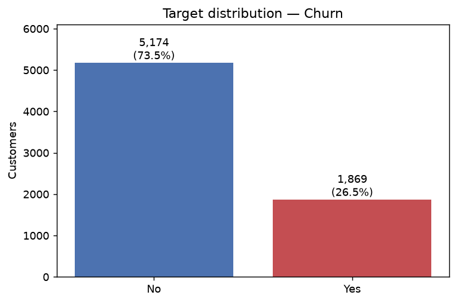
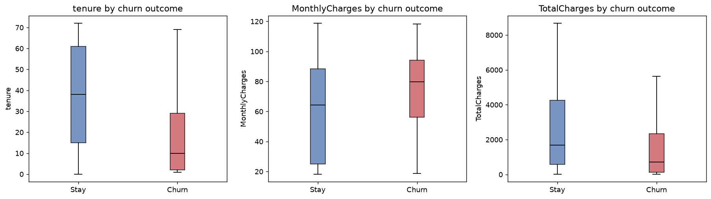
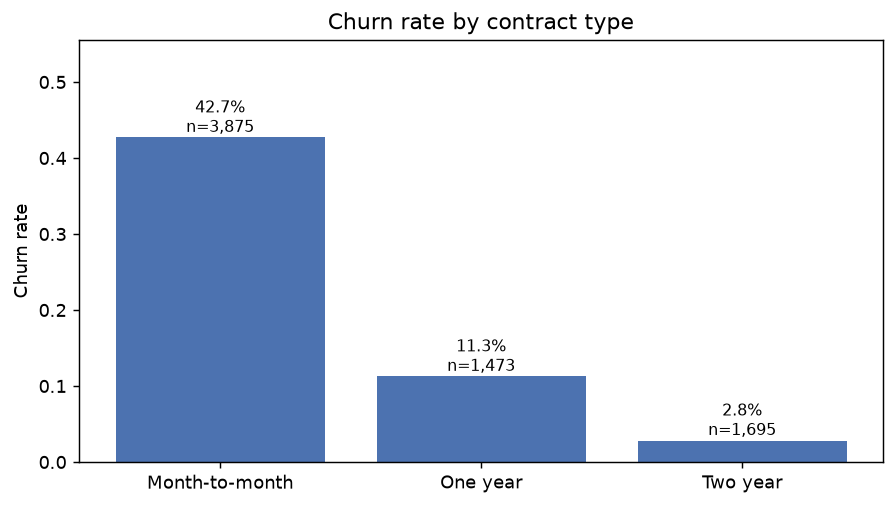
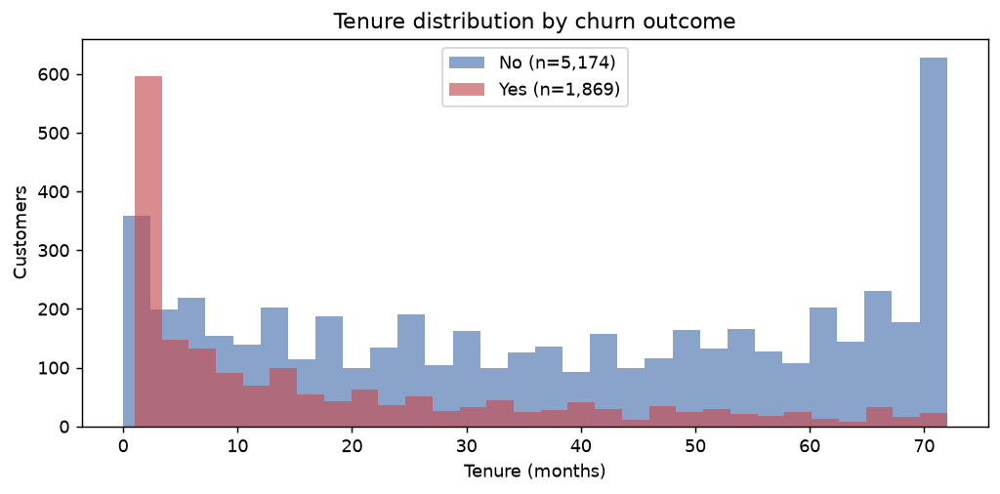
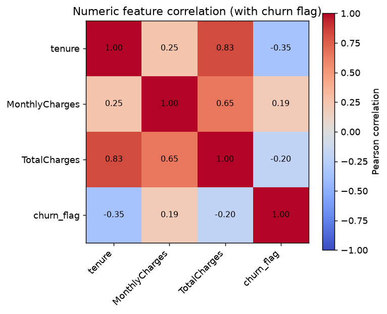
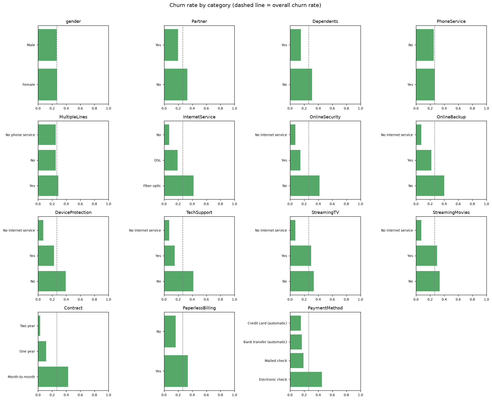

# Exploratory Data Analysis — IBM Telco Customer Churn

_Generated automatically by `python -m churn.data.eda` on 2026-11-19 06:33 UTC._

All figures and numbers below are computed from the verified raw dataset; nothing is hand-entered.

## 1. Dataset shape and size

- Rows: **7,043**
- Columns: **21**
- In-memory size: **7.79 MB**

## 2. Target variable and class imbalance

| Churn | Customers | Share |
| --- | --- | --- |
| No | 5,174 | 73.46% |
| Yes | 1,869 | 26.54% |

- Positive (churn) rate: **26.54%**
- Majority : minority ratio: **2.77 : 1**

**Interpretation.** At roughly a quarter positive rate this is *moderate* imbalance, not severe. The practical consequences:

1. **Accuracy is a misleading metric.** Predicting "nobody churns" scores **73.46% accuracy** and has zero business value.
2. **Resampling (SMOTE) is not the first lever.** With this ratio it distorts the predicted probabilities, and we display those probabilities to users as risk scores. We prefer `class_weight='balanced'` plus threshold tuning, which keep probabilities meaningful.
3. **PR-AUC is the primary metric** because it focuses on the minority class.

## 3. Missing values

pandas reports **no NaN values** — but that is misleading. See the next section.

### 3.1 The `TotalCharges` trap

- Non-numeric entries when coerced: **11**
- Distinct `tenure` values among those rows: **[0]**
- All of them have `tenure == 0`: **True**

These are **not missing at random**. They are brand-new customers whose first invoice has not been generated, so the blank is a structural representation of zero accumulated charges. Correct treatment: coerce to numeric, then **impute 0** (not the mean/median, which would invent revenue that does not exist, and not row deletion, which would drop the highest-churn cohort).

## 4. Duplicates

- Fully duplicated rows: **0**
- Duplicated `customerID` values: **0**

`customerID` is uniquely identifying (0 duplicates), so it carries no generalisable signal and would only let a model memorise rows. **It is dropped before training.**

## 5. Outlier analysis (1.5 x IQR rule)

| Feature | Outliers | Share |
| --- | --- | --- |
| tenure | 0 | 0.00% |
| MonthlyCharges | 0 | 0.00% |
| TotalCharges | 0 | 0.00% |

**Decision: outliers are kept.** Rationale:

- For gradient-boosted trees, outliers are harmless (trees split on rank, not distance).
- For the logistic-regression baseline, `StandardScaler` limits their influence.
- Removing high-`MonthlyCharges` customers would delete precisely the high-value accounts we most want to retain — a business-own goal disguised as data cleaning.

## 6. Numeric features by churn outcome

| feature | churn | mean | median | std | min | max |
| --- | --- | --- | --- | --- | --- | --- |
| tenure | No | 37.57 | 38.00 | 24.11 | 0.00 | 72.00 |
| tenure | Yes | 17.98 | 10.00 | 19.53 | 1.00 | 72.00 |
| MonthlyCharges | No | 61.27 | 64.43 | 31.09 | 18.25 | 118.75 |
| MonthlyCharges | Yes | 74.44 | 79.65 | 24.67 | 18.85 | 118.35 |
| TotalCharges | No | 2555.34 | 1683.60 | 2329.46 | 18.80 | 8672.45 |
| TotalCharges | Yes | 1531.80 | 703.55 | 1890.82 | 18.85 | 8684.80 |

Churners show markedly lower tenure and higher monthly charges, which is consistent with a price-sensitive, month-to-month customer profile.

## 7. Categorical features vs churn

### Contract type (strongest categorical driver)

| Contract | n | churn_rate |
| --- | --- | --- |
| Month-to-month | 3875 | 42.71% |
| One year | 1473 | 11.27% |
| Two year | 1695 | 2.83% |

Month-to-month customers churn at a far higher rate than two-year customers. This is the single most actionable retention lever: converting contracts.

### Internet service

| InternetService | n | churn_rate |
| --- | --- | --- |
| Fiber optic | 3096 | 41.89% |
| DSL | 2421 | 18.96% |
| No | 1526 | 7.40% |

### Payment method

| PaymentMethod | n | churn_rate |
| --- | --- | --- |
| Electronic check | 2365 | 45.29% |
| Mailed check | 1612 | 19.11% |
| Bank transfer (automatic) | 1544 | 16.71% |
| Credit card (automatic) | 1522 | 15.24% |

## 8. Figures

### Target distribution — the imbalance to be aware of

### Numeric feature distributions by churn outcome

### Churn rate by contract type

### Tenure distribution by outcome

### Numeric correlations including the churn flag

### Churn rate across all categorical features

## 9. Implications for modelling

| Finding | Modelling consequence |
| --- | --- |
| 26.5% positive rate | Use PR-AUC; tune the threshold; don't trust accuracy |
| `TotalCharges` blanks all at tenure 0 | Coerce to numeric, impute 0 inside the pipeline |
| `customerID` unique | Drop it — pure leakage risk |
| Outliers on `TotalCharges` | Keep; use trees or scaled linear models |
| Contract type dominant | Expect it in the SHAP global importance ranking |
| Skewed tenure (bimodal) | Trees handle it; consider a tenure-bucket feature |
